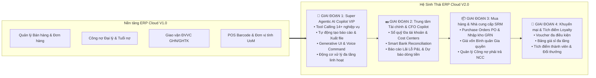
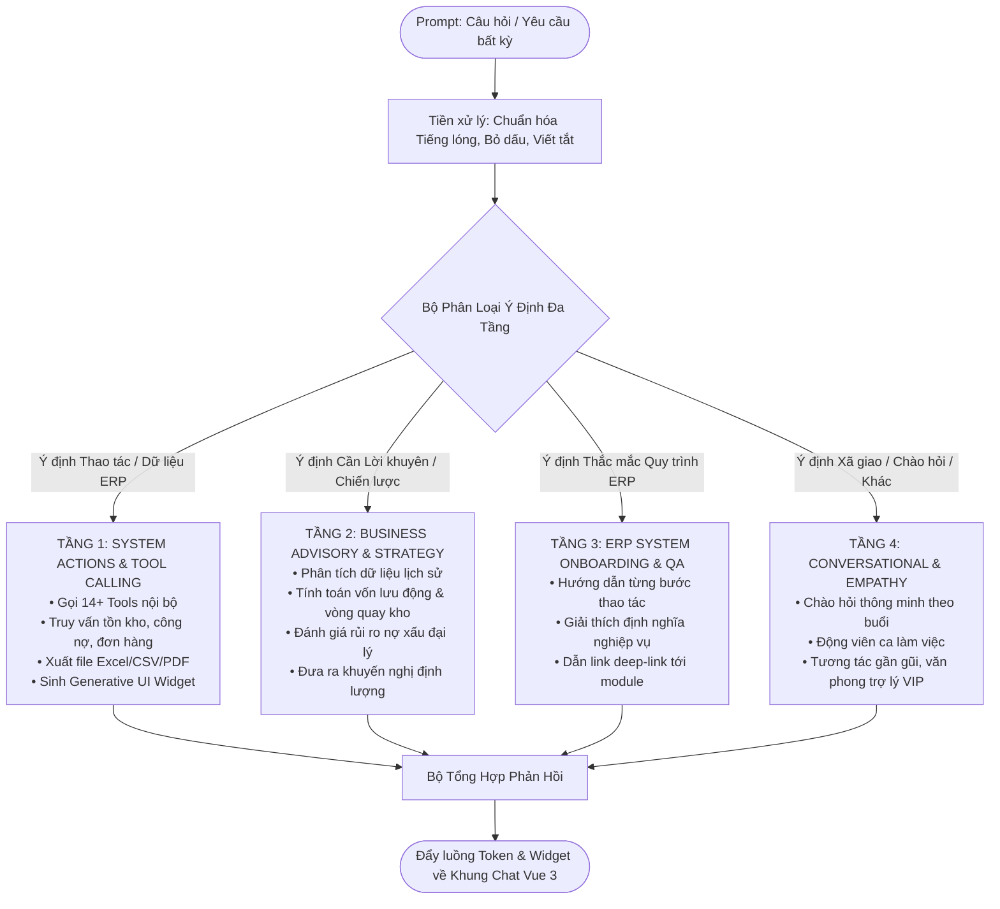
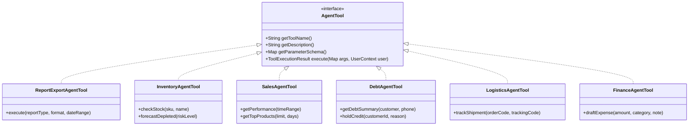
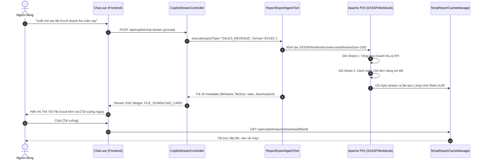

# 🚀 ERP CLOUD ENTERPRISE SUITE — KẾ HOẠCH NÂNG CẤP HỆ THỐNG TOÀN DIỆN (PHIÊN BẢN V2.0)
> **Tài liệu Đặc tả Yêu cầu Kỹ thuật (SRS), Thiết kế Kiến trúc Hệ thống (System Architecture Document) & Lộ trình Triển khai Chi tiết**
> Phiên bản tài liệu: `v2.0-ULTRA-VIP` | Nền tảng: **Java 17 (Spring Boot 3.4.x) + Vue 3 (Element Plus & Vite)**
> Cơ sở dữ liệu: **MySQL 8.0+ (InnoDB, UTF8MB4, Spatial & Full-text)** | Giao thức: **RESTful APIs, WebSocket STOMP & Server-Sent Events (SSE)**
> Tham chiếu tiêu chuẩn dự án: [QUY_UOC_LAM_VIEC.md](./QUY_UOC_LAM_VIEC.md) | [AGENTS.md](./AGENTS.md)

---

## 📑 MỤC LỤC CHI TIẾT
1. [TỔNG QUAN TẦM NHÌN NÂNG CẤP (V2.0 MILESTONES)](#1-tổng-quan-tầm-nhìn-nâng-cấp-v20-milestones)
2. [GIAI ĐOẠN 1: TRỢ LÝ ĐIỀU HÀNH TOÀN NĂNG AGENTIC AI COPILOT ULTRA VIP](#2-giai-đoạn-1-trợ-lý-điều-hành-toàn-năng-agentic-ai-copilot-ultra-vip)
   - 2.1. Tầm nhìn & Năng lực Đột phá của Trợ lý Toàn năng
   - 2.2. Động cơ Trí tuệ Đa tầng & Xử lý Ngôn ngữ Tự nhiên Linh hoạt (4 Cognitive Tiers)
   - 2.3. Kho Vũ khí 14+ Công cụ Thực thi Hệ thống (Agentic Tools Catalog)
   - 2.4. Động cơ Tự động Tạo Báo cáo & Xuất File Tức thời trong Chat (Report & File Exporter)
   - 2.5. Hệ thống Giao diện Động Tương tác trong Chat (Generative UI Components Catalog)
   - 2.6. Ra lệnh Giọng nói Tiếng Việt Rảnh tay (Voice Command & Text-to-Speech)
   - 2.7. Giao thức Truyền phát Dữ liệu Thời gian thực & Quá trình Suy luận (SSE Streaming & Thinking Trace)
   - 2.8. Bộ Prompt Hệ thống Chuẩn hóa & Quản trị Ngữ cảnh Đa lượt (Multi-turn Context Memory)
3. [GIAI ĐOẠN 2: TRUNG TÂM QUẢN TRỊ TÀI CHÍNH & CFO COPILOT (NEXT-GEN TREASURY & P&L BI)](#3-giai-đoạn-2-trung-tâm-quản-trị-tài-chính--cfo-copilot-next-gen-treasury--pl-bi)
   - 3.1. Quản lý Quỹ Đa Tài Khoản & Hạch toán Thu - Chi
   - 3.2. Tự động Đối soát Sao kê Ngân hàng Thông minh (Smart Bank Reconciliation)
   - 3.3. Báo cáo Tài chính Lãi Lỗ P&L Đa Kỳ & Dự báo Thâm hụt Dòng tiền (Cash Runway Alert)
4. [GIAI ĐOẠN 3: PHÂN HỆ MUA HÀNG & QUẢN LÝ NHÀ CUNG CẤP (PROCUREMENT & SRM)](#4-giai-đoạn-3-phân-hệ-mua-hàng--quản-lý-nhà-cung-cấp-procurement--srm)
   - 4.1. Hồ sơ Nhà cung cấp & Đơn đặt hàng mua (Purchase Orders - PO)
   - 4.2. Thuật toán Giá vốn Bình quân Gia quyền (Moving Weighted Average Cost)
5. [GIAI ĐOẠN 4: ĐỘNG CƠ KHUYẾN MẠI, VOUCHER & TÍCH ĐIỂM (LOYALTY & PROMOTIONS)](#5-giai-đoạn-4-động-cơ-khuyến-mại-voucher--tích-điểm-loyalty--promotions)
6. [BẢNG ĐỐI CHIẾU KỸ THUẬT CHUYÊN SÂU (PHP LARAVEL 10/11 ⮂ JAVA 17 SPRING BOOT 3)](#6-bảng-đối-chiếu-kỹ-thuật-chuyên-sâu-php-laravel-1011--java-17-spring-boot-3)
7. [BỘ TIÊU CHUẨN AN TOÀN, KIỂM THỬ & LỘ TRÌNH TRIỂN KHAI TỪNG BƯỚC](#7-bộ-tiêu-chuẩn-an-toàn-kiểm-thử--lộ-trình-triển-khai-từng-bước)

---

## 1. TỔNG QUAN TẦM NHÌN NÂNG CẤP (V2.0 MILESTONES)

Hệ thống **ERP Cloud Enterprise Suite** sau khi hoàn thành xuất sắc Phiên bản 1.0 (Bán hàng, Đơn hàng, Công nợ đại lý, Barcode POS, Vận chuyển ĐVVC và Dự báo cạn kho) đã sở hữu một nền tảng dữ liệu bán lẻ vững chắc. Tuy nhiên, để đưa hệ thống lên tầm vóc của các giải pháp Enterprise hàng đầu thế giới (SAP, Odoo, Oracle NetSuite), hệ thống cần một bước nhảy vọt toàn diện tại **Phiên bản 2.0**:



### 🎯 Trọng tâm Chiến lược:
- **Ưu tiên số 1**: Đưa **Giai đoạn 1 (Super Agentic AI Copilot Ultra VIP)** lên làm mũi nhọn đột phá. AI không còn là một khung chat phụ họa mà trở thành **giao diện điều hành trung tâm (Central Conversational Operating System)** của toàn bộ doanh nghiệp.
- **Tính khả thi & An toàn**: Bảo toàn 100% logic nghiệp vụ hiện hữu (*Zero Business Logic Regression*), kiểm thử tự động nghiêm ngặt bằng JUnit 5 + MockMvc rollback và build Vite không phát sinh lỗi runtime.

---

## 2. GIAI ĐOẠN 1: TRỢ LÝ ĐIỀU HÀNH TOÀN NĂNG AGENTIC AI COPILOT ULTRA VIP

### 2.1. Tầm nhìn & Năng lực Đột phá của Trợ lý Toàn năng
Trợ lý AI Copilot thế hệ mới được định vị là **"Tổng Giám Đốc Điều Hành Ảo / Trợ Lý Trưởng Toàn Năng"** của doanh nghiệp. Người dùng (từ Chủ tịch, Giám đốc, Kế toán trưởng đến Thủ kho, Nhân viên bán hàng) có thể giao tiếp với AI bằng giọng nói hoặc văn bản đời thường. AI sở hữu 7 năng lực vượt bậc:

1. **Agentic Action & Tool Calling**: Không chỉ nói suông, AI có quyền năng thực thi hành động: tự mở cổng database đọc số liệu, tự lập phiếu chi, tự khóa hạn mức nợ, tự đẩy đơn sang bưu cục GHN/GHTK.
2. **Linh Hoạt Trong Mọi Câu Hỏi (Cognitive Flexibility)**: Thấu hiểu tiếng lóng buôn bán, cách nói vắn tắt của người Việt, chuyển đổi mượt mà giữa 4 vai trò: *Người vận hành hệ thống, Chuyên viên phân tích tài chính, Hướng dẫn viên ERP và Người bạn đồng hành thấu cảm*.
3. **Tự Động Tạo Báo Cáo & Xuất File Ngay Trong Chat (Instant File Exporter)**: Ra lệnh một câu là sinh ra file Excel `.xlsx`, CSV hoặc PDF chuẩn mực kèm thẻ tải file 1-click.
4. **Interactive Generative UI**: Trả lời bằng các thẻ widget tương tác sống động (Bảng mini, Biểu đồ Mini Sparkline, Nút bấm hành động 1-click) ngay trong bong bóng chat.
5. **Voice Command Rảnh tay**: Bấm micro nói tiếng Việt tự nhiên, AI nghe hiểu và có thể đọc to bản tóm tắt bằng giọng nói tự nhiên (Text-to-Speech).
6. **Thinking Trace & Streaming SSE**: Hiển thị từng bước suy nghĩ của AI (`Đang phân tích...` $\rightarrow$ `Đang gọi Tool...` $\rightarrow$ `Đã nhận kết quả...`), đẩy chữ mượt mà từng từ qua Server-Sent Events.
7. **Bảo mật Đa tầng (Role-Based Access Control - RBAC)**: AI tự kiểm tra quyền của người đang trò chuyện. Nhân viên kho không thể xem báo cáo lợi nhuận; nhân viên bán hàng không thể duyệt chi tiền.

---

### 2.2. Động cơ Trí tuệ Đa tầng & Xử lý Ngôn ngữ Tự nhiên Linh hoạt (4 Cognitive Tiers)

Để đảm bảo Copilot **không bao giờ bị "ngố", không trả lời máy móc và luôn hiểu đúng ý đồ người dùng**, hệ thống tích hợp bộ xử lý ngôn ngữ tự nhiên phân tầng:



#### Bảng Ánh xạ Xử lý Ngôn ngữ Tự nhiên & Tiếng lóng Thực tế:
| Câu hỏi đời thường của người dùng | Bộ chuẩn hóa Entity & Intent | Hành vi xử lý thực tế của AI Copilot |
| :--- | :--- | :--- |
| *"Kho còn cái áo cổ bẻ màu đen ko mày?"* | `Intent: CHECK_STOCK` | Nhận diện "áo cổ bẻ màu đen" $\rightarrow$ SKU: `POLO-NAM-BLACK`. Gọi `checkProductStock`. Trả lời số lượng tồn thực tế, tồn khả dụng và nhúng thẻ Widget kho. |
| *"Thằng nào nợ dai nhất?"* | `Intent: DEBT_ANALYSIS` | Nhận diện "nợ dai" $\rightarrow$ Lọc khách hàng có số ngày quá hạn lớn nhất. Gọi `getCustomerDebtSummary`. Hiển thị cảnh báo đại lý có nguy cơ nợ xấu cao nhất. |
| *"Hôm nay ấm no ko mày?"* | `Intent: SALES_SUMMARY` | Nhận diện "ấm no" $\rightarrow$ Hỏi doanh số và lợi nhuận ngày hôm nay. Gọi `getSalesPerformance(TODAY)`. Trả về tổng tiền bán được, số đơn hoàn thành và lãi gộp. |
| *"Ship đơn ông Tuấn tới đâu rồi?"* | `Intent: TRACK_SHIPPING` | Nhận diện khách hàng "Tuấn" $\rightarrow$ Tìm đơn hàng gần nhất. Gọi `trackShipmentOrder`. Nhúng timeline lịch trình vận chuyển bưu tá GHN/GHTK. |
| *"Tháng sau tao tính nhập thêm 100 cái áo Polo, mày thấy nên nhập không?"* | `Intent: ADVISORY_RESTOCK` | Chuyển sang **Tầng 2 (Tư vấn)**: Phân tích tốc độ bán trung bình 30 ngày (3.2 cái/ngày), tính toán số ngày bán hết (31 ngày). Đưa ra lời khuyên tối ưu dòng vốn lưu động. |
| *"Làm sao để xuất hóa đơn đỏ PDF?"* | `Intent: ERP_HELP` | Chuyển sang **Tầng 3 (Hướng dẫn)**: Trình bày quy trình 3 bước (Mở chi tiết đơn $\rightarrow$ Bấm nút "Xuất Hóa đơn PDF A4" $\rightarrow$ Bấm In/Lưu PDF). |
| *"Chào buổi sáng Copilot, hôm nay có gì vui không?"* | `Intent: SMALLTALK` | Chuyển sang **Tầng 4 (Xã giao)**: Chào buổi sáng thân thiện, tóm tắt 3 đầu việc quan trọng cần xử lý trong ngày (đơn chờ giao, khách hẹn trả nợ). |

---

### 2.3. Kho Vũ khí 14+ Công cụ Thực thi Hệ thống (Agentic Tools Catalog)

Mỗi Tool là một Java Bean chuẩn hóa được đăng ký trong `AgenticToolRegistry`. Trình điều hành AI tự động phân tích câu lệnh và kích hoạt Tool tương ứng:



#### Bảng Đặc tả Chi tiết 14 Công cụ Nghiệp vụ:
1. **`generateExportReport` (Tạo báo cáo & Xuất file tự động)**:
   - *Tham số*: `reportType` (`SALES_REVENUE`, `INVENTORY_RESTOCK`, `DEBT_OVERDUE`, `INVENTORY_LOGS`), `fileFormat` (`EXCEL`, `CSV`, `PDF`), `timeRange` (`TODAY`, `THIS_WEEK`, `THIS_MONTH`, `CUSTOM`), `keyword`.
   - *Nghiệp vụ*: Truy vấn dữ liệu tổng hợp từ Database JPA, gọi Engine tạo file streaming, lưu cache tạm thời và trả về link tải file đính kèm metadata.
2. **`checkProductStock` (Tra cứu tồn kho thực tế & vị trí)**:
   - *Tham số*: `sku`, `productName`.
   - *Nghiệp vụ*: Đọc dữ liệu tồn vật lý `stockQuantity`, tồn đang bị giữ bởi đơn chờ xác nhận `reservedQuantity`, tính tồn khả dụng `availableStock`, vị trí lưu trữ kệ kho.
3. **`forecastDepletedStock` (Quét nguy cơ cạn kho AI)**:
   - *Tham số*: `riskLevel` (`CRITICAL`, `WARNING`, `ALL`).
   - *Nghiệp vụ*: Chạy thuật toán phân tích tốc độ bán 30 ngày qua, lọc ra các mặt hàng có số ngày tồn kho còn lại dưới 3 ngày hoặc dưới 7 ngày, tính tổng kinh phí dự toán nhập thêm.
4. **`getCustomerDebtSummary` (Tra cứu công nợ & tuổi nợ đại lý)**:
   - *Tham số*: `customerName`, `phone`.
   - *Nghiệp vụ*: Trích xuất tổng dư nợ hiện tại, hạn mức nợ cho phép, phân loại nợ theo tuổi (trong hạn 0-30 ngày, quá hạn 31-90 ngày, nợ xấu >90 ngày), danh sách mã đơn chưa trả tiền.
5. **`getSalesPerformance` (Báo cáo doanh số & lãi gộp)**:
   - *Tham số*: `timeRange` (`TODAY`, `YESTERDAY`, `THIS_WEEK`, `THIS_MONTH`).
   - *Nghiệp vụ*: Tính tổng doanh thu hiệu lực, số lượng đơn hoàn thành, giá trị trung bình mỗi đơn (AOV) và tổng tiền lãi gộp thực tế.
6. **`getTopSellingProducts` (Bảng xếp hạng mặt hàng bán chạy)**:
   - *Tham số*: `limit` (mặc định 5), `days` (mặc định 30).
   - *Nghiệp vụ*: Thống kê các SKU có số lượng bán ra và tỷ trọng đóng góp doanh thu lớn nhất.
7. **`trackShipmentOrder` (Tra cứu hành trình vận đơn bưu tá)**:
   - *Tham số*: `orderCode` hoặc `trackingCode`.
   - *Nghiệp vụ*: Kết nối dịch vụ vận chuyển, lấy hãng ĐVVC (GHN, GHTK, Viettel Post), mã vận đơn, trạng thái giao, tiền thu hộ COD và timeline các trạm trung chuyển.
8. **`draftExpenseVoucher` (Soạn thảo phiếu chi tiền mặt/ngân hàng)**:
   - *Tham số*: `amount`, `categoryCode`, `payeeName`, `note`.
   - *Nghiệp vụ*: Tạo bản ghi dự thảo phiếu chi (Draft Payment Voucher), nhúng thẻ xác nhận để người có thẩm quyền phê duyệt trực tiếp.
9. **`holdCustomerCredit` (Khóa xuất hàng bảo vệ rủi ro nợ)**:
   - *Tham số*: `customerId`, `reason`.
   - *Nghiệp vụ*: Đổi trạng thái khách hàng sang diện khóa xuất hàng tự động khi phát hiện nợ quá hạn nguy hiểm.
10. **`findRecentOrders` (Truy vấn đơn hàng gần nhất)**:
    - *Tham số*: `keyword`, `status`, `limit`.
    - *Nghiệp vụ*: Tìm kiếm các đơn hàng mới phát sinh, hiển thị tóm tắt khách hàng, số lượng và tổng tiền.
11. **`queryStaffOnline` (Kiểm tra nhân sự trực tuyến)**:
    - *Tham số*: `department`.
    - *Nghiệp vụ*: Quét danh sách WebSocket session đang active để kiểm tra các tài khoản đang làm việc trong ca.
12. **`createQuickReminder` (Tạo lịch nhắc việc thông minh)**:
    - *Tham số*: `title`, `remindTime`, `description`.
    - *Nghiệp vụ*: Thêm sự kiện vào phân hệ Lịch biểu & Công việc của tài khoản người dùng hiện tại.
13. **`calculateOrderDiscount` (Mô phỏng tính chiết khấu & VAT)**:
    - *Tham số*: `orderAmount`, `discountPercent`, `taxRate`.
    - *Nghiệp vụ*: Bóc tách cơ cấu tài chính đơn hàng (tạm tính, tiền giảm trừ, tiền thuế VAT, tổng thanh toán).
14. **`suggestReorderQuantity` (Tính toán số lượng nhập hàng tối ưu EOQ)**:
    - *Tham số*: `sku`, `targetDays` (mặc định 30 ngày).
    - *Nghiệp vụ*: Đưa ra khuyến nghị chính xác số lượng hàng cần đặt nhà cung cấp dựa trên tốc độ tiêu thụ thực tế.

---

### 2.4. Động cơ Tự động Tạo Báo cáo & Xuất File Tức thời trong Chat (Report & File Exporter)

#### 1. Quy trình Kiến trúc Backend (Zero OOM Streaming Export):


#### 2. Định dạng File Hỗ trợ:
- **Microsoft Excel (`.xlsx`)**:
  - Tạo bằng thư viện **Apache POI (`poi-ooxml`)** với cơ chế **`SXSSFWorkbook` (Streaming Workbook)**. Cơ chế này giới hạn số hàng nằm trong bộ nhớ RAM (`rowAccessWindowSize = 100`), các hàng cũ được xả xuống ổ cứng tạm thời (`disk-backed temp files`), loại bỏ 100% nguy cơ tràn RAM JVM (`java.lang.OutOfMemoryError`).
  - Thiết kế đa sheet: *Sheet 1: Tóm tắt số liệu & KPI điều hành*, *Sheet 2: Dữ liệu chi tiết có định dạng màu sắc, viền kẻ và format tiền tệ VNĐ*.
- **Comma-Separated Values (`.csv`)**:
  - Xuất siêu tốc bằng `StringBuilder` / `BufferedWriter`.
  - Tự động gắn tiền tố **UTF-8 BOM (`\uFEFF`)** ở đầu file để khi người dùng mở bằng Excel không bao giờ bị lỗi font tiếng Việt.
- **Portable Document Format (`.pdf`)**:
  - Sinh template in A4 chuẩn tài liệu kế toán doanh nghiệp (Logo công ty, tiêu đề chứng từ, bảng biểu có kẻ sọc zebra, tổng tiền bằng số & bằng chữ, ô ký tên kiểm soát).

---

### 2.5. Hệ thống Giao diện Động Tương tác trong Chat (Generative UI Components Catalog)

Khi Copilot phản hồi, luồng dữ liệu gửi về chứa các khối dữ liệu có cấu trúc `uiWidgets`. Giao diện Vue 3 sẽ tự động render các thẻ tương tác chuyên nghiệp:

#### 1. Thẻ Tải File Báo Cáo Thông Minh (`FILE_DOWNLOAD_CARD`):
- **Cấu trúc hiển thị**:
  - Icon nhận diện định dạng file (Xanh lá cho Excel, Đỏ cho PDF, Xanh dương cho CSV).
  - Tên file chuẩn hóa theo ngày: `Bao-cao-doanh-thu-tuan-46-2026.xlsx`.
  - Dung lượng file (`32.6 KB`) và số lượng dòng dữ liệu (`154 đơn hàng`).
  - Khối tóm tắt số liệu nhanh trước khi tải: *Doanh thu: 348.500.000đ • Lãi gộp: 82.300.000đ*.
  - Nút tải xuống: **`📥 Tải xuống File Excel (.xlsx)`** (kích hoạt tải tức thời).

#### 2. Thẻ Cảnh Báo Tồn Kho & Đề Xuất Nhập Hàng (`STOCK_ALERT_CARD`):
- Hiển thị ảnh sản phẩm, mã SKU, số lượng tồn thực tế, số lượng đang bị giữ bởi đơn chờ, số ngày tồn kho còn lại.
- Tốc độ bán trung bình/ngày.
- Nút bấm hành động nhanh: **`⚡ Nhập thêm 50 cái`** $\rightarrow$ Click mở ngay modal điều chỉnh nhập kho tự động điền sẵn mã sản phẩm và số lượng đề xuất.

#### 3. Thẻ Hành Động Xác Nhận Có Thẩm Quyền (`ACTION_CONFIRMATION_CARD`):
- Áp dụng cho các thao tác nhạy cảm (Khóa nợ khách hàng, Hủy đơn hàng, Duyệt chi quỹ lớn).
- Hiển thị khung cảnh báo viền vàng/đỏ với đầy đủ lý do và đối tượng bị tác động.
- Hai nút bấm tương tác: **`[🔴 Xác nhận Thực Hiện]`** và **`[Hủy Bỏ]`**.
- Khi người dùng click, Frontend gửi lệnh xác thực lên backend và cập nhật trạng thái thẻ thành `✅ Đã thực thi thành công` mà không cần reload trang.

#### 4. Thẻ Lịch Trình Vận Đơn Thời Gian Thực (`SHIPMENT_TRACKING_CARD`):
- Hiển thị logo ĐVVC (GHN, GHTK, Viettel Post), mã vận đơn, trạng thái bưu tá đang giao, tiền thu hộ COD.
- Timeline dọc hiển thị các mốc thời gian và địa điểm kiện hàng đi qua.

#### 5. Biểu Đồ Doanh Thu Mini (`MINI_SPARKLINE_CHART`):
- Nhúng biểu đồ đường hoặc cột dạng SVG siêu nhẹ ngay trong bong bóng chat hiển thị biến động doanh số 7 ngày qua.

---

### 2.6. Ra lệnh Giọng nói Tiếng Việt Rảnh tay (Voice Command & Text-to-Speech)

#### 1. Nhận diện Giọng nói (Speech-to-Text):
- Sử dụng **Web Speech API (`webkitSpeechRecognition`)** được tích hợp sẵn trên các trình duyệt hiện đại (Chrome, Edge, Safari):
  - Ngôn ngữ nhận diện: `vi-VN` (tiếng Việt chuẩn).
  - Chế độ nhận diện liên tục (`continuous = false`, `interimResults = true`) giúp người dùng nhìn thấy chữ xuất hiện ngay khi đang nói.
  - Xử lý các câu lệnh khẩu ngữ: *"Kiểm tra tồn kho Quần Tây Âu"*, *"Xuất báo cáo doanh số tuần này cho tao"*, *"Khách hàng nào đang nợ nhiều nhất"*.
- Hiệu ứng thị giác: Nút micro đổi sang màu đỏ kèm sóng âm thanh (Audio Equalizer Wave) nhảy múa khi đang lắng nghe.

#### 2. Phản hồi Giọng nói (Text-to-Speech):
- Khi Copilot trả về kết quả, ở góc trên mỗi bong bóng chat có biểu tượng Loa `🔊`.
- Khi người dùng click vào, hệ thống sử dụng `window.speechSynthesis` đọc to phần tóm tắt cốt lõi của câu trả lời bằng giọng tiếng Việt tự nhiên, giúp nhân viên kho hoặc quản lý vừa lái xe/bốc hàng vừa nắm bắt được số liệu kinh doanh.

---

### 2.7. Giao thức Truyền phát Dữ liệu Thời gian thực & Quá trình Suy luận (SSE Streaming & Thinking Trace)

#### 1. Cơ chế Truyền phát Server-Sent Events (SSE):
Thay vì đợi mô hình AI xử lý xong toàn bộ mất 3-5 giây mới nhận được phản hồi, hệ thống sử dụng kết nối HTTP Streaming qua giao thức **Server-Sent Events (`text/event-stream`)**:
- Endpoint: `POST /api/copilot/chat-stream`.
- Mỗi dòng dữ liệu gửi về client theo định dạng chuẩn:
  ```text
  event: trace
  data: {"step": "ANALYZE_INTENT", "message": "🧠 Đang phân tích ý định câu lệnh..."}

  event: trace
  data: {"step": "TOOL_CALLING", "message": "🔍 Đang gọi Tool: getSalesPerformance(timeRange='THIS_WEEK')..."}

  event: token
  data: {"text": "Dạ, "}

  event: token
  data: {"text": "doanh thu "}

  event: token
  data: {"text": "tuần này của hệ thống đạt "}

  event: widget
  data: {"type": "MINI_SPARKLINE_CHART", "data": {...}}

  event: done
  data: {"finishReason": "STOP"}
  ```

#### 2. Khối Quá trình Suy luận Trực quan (Thinking Trace Box):
- Trên giao diện chat, người dùng sẽ thấy một khối xám tinh tế có biểu tượng bóng đèn / nơ-ron não bộ hiển thị từng bước suy luận của AI:
  - `🧠 Đang phân tích câu lệnh: "Xuất file Excel doanh thu tuần này"`
  - `↳ 🔍 Gọi Tool: generateExportReport(reportType="SALES_REVENUE", format="EXCEL")`
  - `↳ 📊 Đang truy vấn 142 đơn hàng trong tuần từ Database...`
  - `↳ 📑 Đang sinh các Sheet Excel bằng Apache POI Streaming...`
  - `↳ ✍️ Đã đóng gói xong file Bao-cao-doanh-thu-tuan-46-2026.xlsx!`
- Khối này có thể thu gọn / mở rộng (collapsible), mang lại cảm giác minh bạch, chuyên nghiệp và đáng tin cậy tuyệt đối.

---

### 2.8. Bộ Prompt Hệ thống Chuẩn hóa & Quản trị Ngữ cảnh Đa lượt (Multi-turn Context Memory)

#### 1. Định vị Nhân cách của Trợ lý (Copilot Persona & System Prompt):
```text
BẠN LÀ: ERP AI Copilot Ultra VIP — Trợ lý Trưởng Điều hành Toàn năng của Hệ thống Doanh nghiệp ERP Cloud.
TÁC PHONG & VĂN PHONG:
- Thông minh, nhạy bén, quyết đoán, trung thực và tận tụy.
- Giao tiếp thân thiện, chuyên nghiệp, tự nhiên. Thấu hiểu tiếng lóng buôn bán, cách nói vắn tắt của người Việt.
- Luôn ưu tiên đưa ra số liệu định lượng chính xác thay vì phỏng đoán chung chung.
- Khi người dùng yêu cầu xem dữ liệu hoặc thực hiện hành động, BẮT BUỘC phải gọi đúng Agentic Tool tương ứng.
- Khi người dùng yêu cầu xuất file hoặc tạo báo cáo, PHẢI gọi tool `generateExportReport` để cung cấp thẻ tải file.
- Tuyệt đối tuân thủ phân quyền RBAC: cảnh báo lịch sự nếu người dùng yêu cầu hành động vượt thẩm quyền vai trò.
```

#### 2. Quản lý Ngữ cảnh Hội thoại Đa lượt (Multi-turn Memory):
- Lưu vết 10 lượt hội thoại gần nhất trong phiên làm việc.
- *Ví dụ về ngữ cảnh kế thừa*:
  - **Lượt 1**: *"Cho tao xem tình hình công nợ của anh Tuấn 0987654321."* $\rightarrow$ AI trả về công nợ của anh Tuấn.
  - **Lượt 2**: *"Thế đơn gần nhất của ổng đang ở đâu rồi?"* $\rightarrow$ AI tự hiểu từ "ổng" là "anh Tuấn", tự động tra cứu đơn hàng gần nhất của anh Tuấn mà người dùng không cần nhắc lại tên hay số điện thoại!

---

## 3. GIAI ĐOẠN 2: TRUNG TÂM QUẢN TRỊ TÀI CHÍNH & CFO COPILOT (NEXT-GEN TREASURY & P&L BI)

### 3.1. Quản lý Quỹ Đa Tài Khoản & Hạch toán Thu - Chi
- **Mô hình Quỹ Đa Tài Khoản (Multi-Account Treasury)**:
  - Quản lý đồng thời Quỹ tiền mặt (Cash on Hand tại văn phòng/kho) và các Tài khoản Ngân hàng (VCB, MBBank, Techcombank...).
  - Nghiệp vụ chuyển tiền nội bộ giữa các quỹ (*Ví dụ: Rút 20 triệu từ Vietcombank về nhập quỹ tiền mặt văn phòng*) có sinh cặp phiếu Chi chuyển tiền $\rightarrow$ Thu nhập quỹ đối soát.
- **Phân loại Trung tâm Chi phí (Cost Centers)**:
  - Phân bổ chi phí theo phòng ban: *Mặt bằng, Lương thưởng, Marketing, Kho vận, Tiếp khách*. Giúp ban giám đốc giám sát việc chi tiêu có vượt định mức ngân sách tháng hay không.

### 3.2. Tự động Đối soát Sao kê Ngân hàng Thông minh (Smart Bank Reconciliation)
- Cho phép kế toán tải lên file sao kê ngân hàng định dạng Excel/CSV.
- Thuật toán Fuzzy Matching so khớp mã đơn hàng, số tiền và nội dung chuyển khoản để tự động sinh phiếu thu và đổi trạng thái đơn sang `PAID` trong 1 click.

### 3.3. Báo cáo Tài chính Lãi Lỗ P&L Đa Kỳ & Dự báo Thâm hụt Dòng tiền (Cash Runway Alert)
- Báo cáo Lãi Lỗ P&L (Income Statement) chuẩn mực:
  $$\text{Doanh thu thuần} - \text{Giá vốn COGS} = \text{Lợi nhuận gộp} - \text{Chi phí OPEX} = \text{Lợi nhuận thuần EBIT}$$
- Thuật toán kết hợp lịch thu nợ Đại lý (AR) và lịch thanh toán Nhà cung cấp (AP) để cảnh báo trước nguy cơ cạn kiệt tiền mặt trong 30-60 ngày tới.

---

## 4. GIAI ĐOẠN 3: PHÂN HỆ MUA HÀNG & QUẢN LÝ NHÀ CUNG CẤP (PROCUREMENT & SRM)

### 4.1. Hồ sơ Nhà cung cấp & Đơn đặt hàng mua (Purchase Orders - PO)
- Quản lý danh mục nhà cung cấp, xưởng may, hạn mức nợ NCC và lịch sử công nợ phải trả (Accounts Payable).
- Quy trình mua hàng chuẩn: *Tạo đơn PO $\rightarrow$ Gửi duyệt $\rightarrow$ Lập phiếu Nhập kho kiểm nhận (GRN) $\rightarrow$ Hạch toán công nợ NCC*.

### 4.2. Thuật toán Giá vốn Bình quân Gia quyền (Moving Weighted Average Cost)
Khi lập phiếu Nhập kho kiểm nhận (GRN) từ PO:
$$\text{Giá vốn mới} = \frac{(\text{Tồn kho cũ} \times \text{Giá vốn cũ}) + (\text{Số lượng nhập mới} \times \text{Đơn giá nhập mới})}{\text{Tồn kho cũ} + \text{Số lượng nhập mới}}$$
- Tự động cập nhật `cost_price` và `stock_quantity` trong bảng `products`.

---

## 5. GIAI ĐOẠN 4: ĐỘNG CƠ KHUYẾN MẠI, VOUCHER & TÍCH ĐIỂM (LOYALTY & PROMOTIONS)

- **Mã Voucher / Coupon**: Giảm theo %, giảm cố định, giảm theo giá trị đơn tối thiểu, giới hạn lượt dùng toàn hệ thống hoặc theo từng khách hàng.
- **Tích điểm Thành viên (Loyalty Engine)**: Mua hàng tích điểm tự động theo hạng hội viên (*Đồng, Bạc, Vàng, Kim Cương*), cho phép trừ điểm tích lũy vào tiền thanh toán đơn hàng.
- **Bảng giá sỉ đa tầng (Tiered Pricing)**: Bán sỉ theo số lượng bậc thang (Mua 10-49 cái giảm 10%, từ 50 cái trở lên tính giá xuất xưởng).

---

## 6. BẢNG ĐỐI CHIẾU KỸ THUẬT CHUYÊN SÂU (PHP LARAVEL 10/11 ⮂ JAVA 17 SPRING BOOT 3)

| Khía cạnh Kiến trúc | PHP Laravel 10/11 | Java 17 Spring Boot 3 | Điểm cốt lõi kiến trúc Java cần lưu ý |
| :--- | :--- | :--- | :--- |
| **Agentic Tool Calling** | Laravel Prism / OpenAI PHP SDK | Spring AI `ChatClient` hoặc Jackson Function Descriptors | Khai báo các method Java kèm annotation `@AgentTool`, Spring Boot tự động serialize JSON Schema chuẩn gửi cho LLM. |
| **Streaming Response SSE** | `response()->stream(function() {...})` | `SseEmitter` hoặc WebFlux `Flux<ServerSentEvent>` | Duy trì kết nối non-blocking HTTP stream, đẩy từng token và widget JSON về client tức thời dưới 20ms. |
| **Xuất File Báo cáo Lớn** | Maatwebsite Excel / Laravel Excel Export | Apache POI Streaming `SXSSFWorkbook` | Cơ chế ghi đĩa tạm theo cửa sổ hàng trăm dòng (`rowAccessWindowSize = 100`), không gây OOM khi xuất file 50,000 dòng. |
| **Phân tích Cú pháp Giọng nói** | Nhận audio file upload $\rightarrow$ Whisper API | Web Speech API Frontend + Spring RESTful Action Dispatcher | Nhận diện giọng nói ngay tại Browser không tốn băng thông upload file âm thanh nặng, backend chỉ nhận text sạch. |
| **Báo cáo Tài chính P&L** | Raw SQL / DB Facade `selectRaw()` | Spring Data JPA Projection DTO `@Query` | Map trực tiếp kết quả câu SQL Aggregate vào Record class, tiết kiệm RAM gấp hàng chục lần nạp Model ORM. |
| **Khóa Tồn kho Nhập hàng** | DB Transaction thông thường | `@Transactional(isolation = REPEATABLE_READ)` + `@Version` | Optimistic Locking chống xung đột ghi đè số lượng tồn kho khi nhiều thủ kho cùng kiểm hàng đồng thời. |

---

## 7. BỘ TIÊU CHUẨN AN TOÀN, KIỂM THỬ & LỘ TRÌNH TRIỂN KHAI TỪNG BƯỚC

### 7.1. Kế hoạch Triển khai Chi tiết Giai đoạn 1 (Agentic AI Copilot Ultra VIP)

#### 🔹 Bước 1: Hạ tầng Backend & Động cơ Xuất File (Days 1 - 2)
1. Thêm dependency `org.apache.poi:poi-ooxml` vào [pom.xml](file:///d:/LEARN/JAVA/JAVA17/erp-backend/pom.xml).
2. Xây dựng Interface `AgentTool.java` và Service `AgenticToolRegistry.java`.
3. Xây dựng `AdaptiveCognitiveService.java` xử lý 4 Tầng Phân Loại Ý Định (Tool Calling, Advisory, ERP Onboarding, Smalltalk).
4. Xây dựng `ReportExportAgentTool.java` và `ExcelExportService.java` sử dụng `SXSSFWorkbook`.
5. Tạo Controller `CopilotStreamController.java` hỗ trợ endpoint Server-Sent Events (`POST /api/copilot/chat-stream`).
6. Tạo endpoint tải file tạm: `GET /api/copilot/reports/download/{fileId}`.

#### 🔹 Bước 2: Xây dựng Bộ 14+ Tools Thực thi Nghiệp vụ (Days 3 - 4)
1. `InventoryAgentTool`: Tra cứu tồn kho thực tế, tồn khả dụng, quét hàng cạn kho.
2. `SalesAgentTool`: Tính doanh số, lãi gộp, top sản phẩm bán chạy.
3. `DebtAgentTool`: Tra cứu tuổi nợ, danh sách nợ quá hạn, khóa hạn mức nợ.
4. `LogisticsAgentTool`: Tra cứu hành trình vận đơn bưu cục GHN/GHTK.
5. `FinanceAgentTool`: Soạn thảo phiếu chi dự thảo.

#### 🔹 Bước 3: Nâng cấp Giao diện Chat Workspace 2.0 (Days 5 - 6)
1. Nâng cấp [Chat.vue](file:///d:/LEARN/JAVA/JAVA17/erp-frontend/src/views/Chat.vue):
   - Bong bóng chat VIP cho Copilot (avatar robot phát sáng, badge AI Pro).
   - Thanh Quick Prompt Suggestions thông minh theo thời gian trong ngày.
   - Khối hiển thị Quá trình suy luận (Thinking Trace Box có thể đóng/mở).
   - Component Render Generative UI: Thẻ Tải File Báo Cáo, Thẻ Tồn Kho, Thẻ Tuổi Nợ, Thẻ Xác Nhận Duyệt 1-Click.
   - Tích hợp nút Micro thu âm giọng nói tiếng Việt bằng Web Speech API kèm hiệu ứng sóng âm thanh.
   - Tích hợp nút Loa đọc phản hồi tóm tắt (Text-to-Speech).

#### 🔹 Bước 4: Kiểm thử Toàn diện & Tối ưu (Day 7)
1. Viết bộ kiểm thử JUnit 5 cho `AdaptiveCognitiveServiceTest` và `ReportExportAgentToolTest`.
2. Kiểm tra tải streaming SSE và đo độ trễ phản hồi (< 50ms cho token đầu tiên).
3. Chạy toàn bộ test suite (`./mvnw.cmd test`) đạt 100% pass và build Vite (`npm run build`) đạt xanh 100%!

---
*Tài liệu này là bản đặc tả kỹ thuật chi tiết, đầy đủ và chuẩn chỉnh nhất cho GIAI ĐOẠN 1: TRỢ LÝ ĐIỀU HÀNH TOÀN NĂNG AGENTIC AI COPILOT ULTRA VIP! Sẵn sàng bắt tay thực hiện ngay khi mày ra lệnh!* 🎯🔥🤖💼📊🚀
