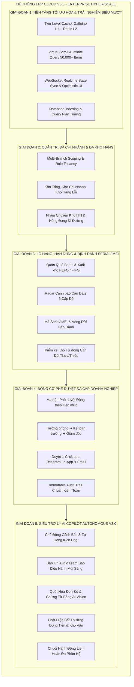
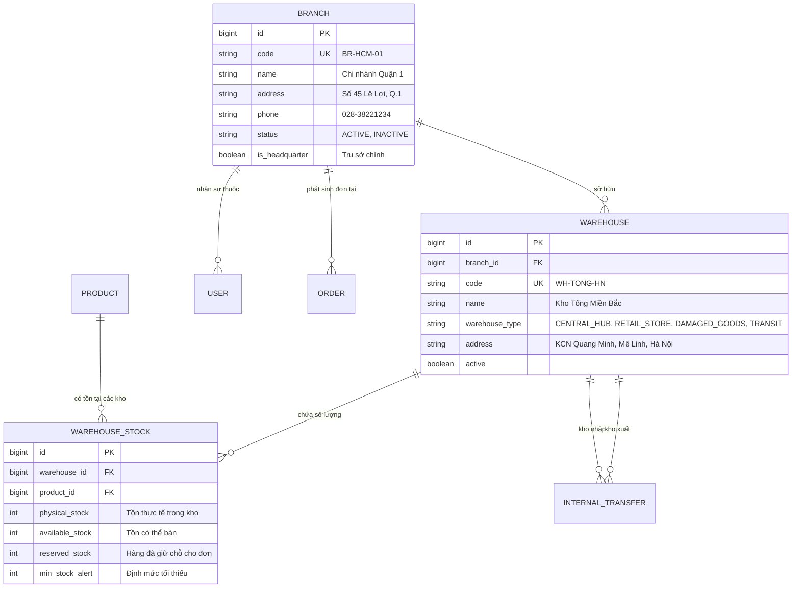
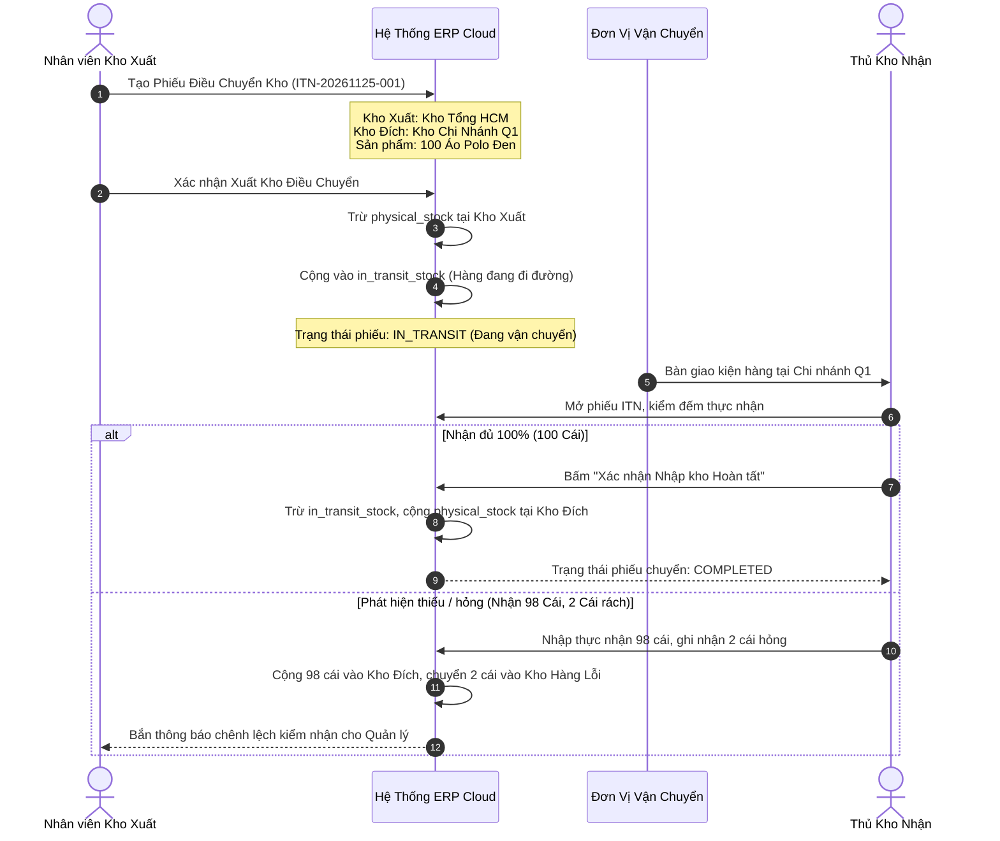
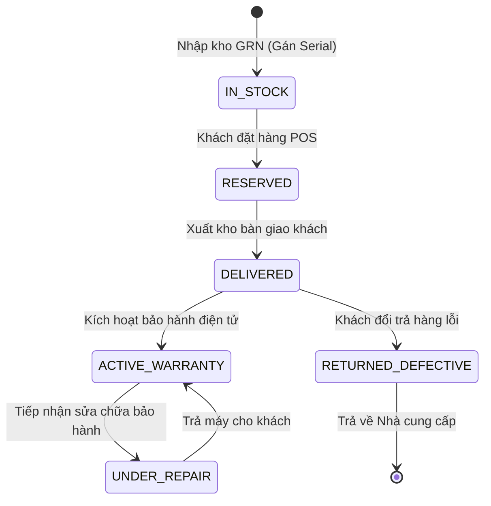
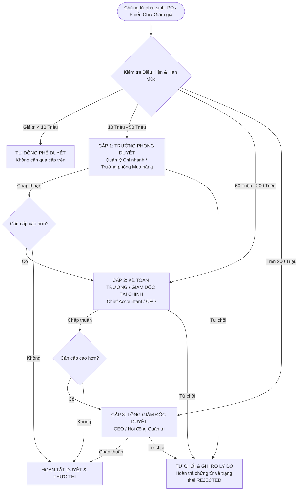
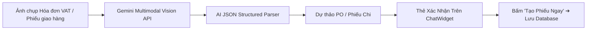
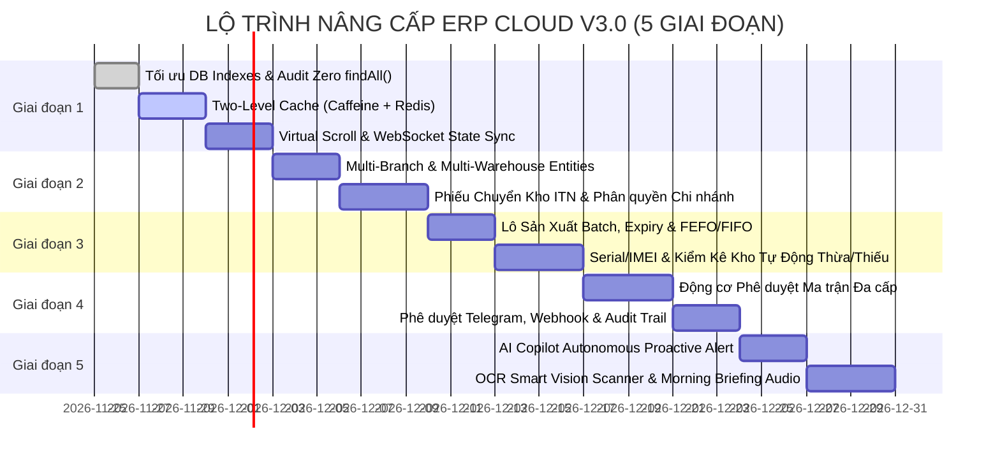

# 🚀 ERP CLOUD ENTERPRISE SUITE — KẾ HOẠCH NÂNG CẤP HỆ THỐNG TOÀN DIỆN (PHIÊN BẢN V3.0)
> **Tài liệu Đặc tả Yêu cầu Kỹ thuật (SRS), Thiết kế Kiến trúc Hệ thống (System Architecture Document) & Lộ trình Triển khai Chi tiết**
> Phiên bản tài liệu: `v3.0-ENTERPRISE-HYPER-SCALE` | Nền tảng: **Java 17 (Spring Boot 3.4.x) + Vue 3 (Element Plus & Vite)**
> Cơ sở dữ liệu: **MySQL 8.0+ (InnoDB, UTF8MB4, Spatial & Full-text)** | Giao thức: **RESTful APIs, WebSocket STOMP, SSE & Redis Pub/Sub**
> Tham chiếu tiêu chuẩn dự án: [QUY_UOC_LAM_VIEC.md](./QUY_UOC_LAM_VIEC.md) | [AGENTS.md](./AGENTS.md) | [update_erp_2.md](./update_erp_2.md)

---

## 📑 MỤC LỤC CHI TIẾT
1. [TỔNG QUAN TẦM NHÌN NÂNG CẤP V3.0 (HYPER-SCALE & SEAMLESS UX)](#1-tổng-quan-tầm-nhìn-nâng-cấp-v30-hyper-scale--seamless-ux)
2. [GIAI ĐOẠN 1: TỐI ƯU HÓA TOÀN DIỆN, ZERO-LAG & TRẢI NGHIỆM SIÊU MƯỢT MÀ (HYPER-PERFORMANCE & OPTIMISTIC UX)](#2-giai-đoạn-1-tối-ưu-hóa-toàn-diện-zero-lag--trải-nghiệm-siêu-mượt-mà-hyper-performance--optimistic-ux)
   - 2.1. Rà soát & Tái cấu trúc Toàn diện Mã nguồn Cũ (Database Indexing & Query Audit)
   - 2.2. Cơ chế Bộ Nhớ Đệm Đa Tầng (Two-Level Caching: Caffeine L1 + Redis L2)
   - 2.3. Bảng Dữ Liệu Cuộn Vô Tận (Virtual Scrolling & Infinite Queries) Chống Giật Lag
   - 2.4. Đồng Bộ Hóa Thời Gian Thực (WebSocket Realtime State Synchronizer) & Optimistic UI
   - 2.5. Trải Nghiệm Khung Xương (Shimmer Skeleton Loading) & Micro-interactions Sang Trọng
3. [GIAI ĐOẠN 2: QUẢN TRỊ ĐA CHI NHÁNH & ĐA KHO HÀNG CHUYÊN SÂU (MULTI-BRANCH, MULTI-WAREHOUSE & INTER-TRANSFER)](#3-giai-đoạn-2-quản-trị-đa-chi-nhánh--đa-kho-hàng-chuyên-sâu-multi-branch-multi-warehouse--inter-transfer)
   - 3.1. Mô hình Doanh nghiệp Chuỗi Đa Chi nhánh & Kho Trung tâm
   - 3.2. Quản lý Tồn kho Đa điểm & Phân bổ Tồn khả dụng theo Kho
   - 3.3. Quy trình Điều chuyển Kho Nội bộ (Internal Transfer Note - ITN) & Hàng Đang Đi Đường
   - 3.4. Phân Quyền Dữ Liệu Theo Chi Nhánh (Data Scoping / Multi-Tenancy by Branch)
4. [GIAI ĐOẠN 3: QUẢN LÝ LÔ SẢN XUẤT, HẠN DÙNG & ĐỊNH DANH SERIAL/IMEI (BATCH/LOT, EXPIRY & SERIAL TRACKING)](#4-giai-đoạn-3-quản-lý-lô-sản-xuất-hạn-dùng--định-danh-serialimei-batchlot-expiry--serial-tracking)
   - 4.1. Quản trị Lô Hàng (Batch/Lot Number) & Chiến lược Xuất kho FEFO / FIFO
   - 4.2. Hệ Thống Cảnh Báo Hàng Cận Date Đa Cấp Độ (Expiry Risk Radar)
   - 4.3. Quản lý Mã Định Danh Serial / IMEI Từng Sản Phẩm & Bảo Hành Điện Tử
   - 4.4. Quy trình Kiểm Kê Kho (Stocktake Audit) & Tự Động Xử Lý Thừa/Thiếu
5. [GIAI ĐOẠN 4: ĐỘNG CƠ PHÊ DUYỆT QUY TRÌNH NGHIỆP VỤ ĐA CẤP (MULTI-LEVEL WORKFLOW & APPROVAL ENGINE)](#5-giai-đoạn-4-động-cơ-phê-duyệt-quy-trình-nghiệp-vụ-đa-cấp-multi-level-workflow--approval-engine)
   - 5.1. Kiến trúc Động cơ Phê duyệt Động (Configurable Dynamic Approval Matrix)
   - 5.2. Luồng Phê duyệt Hạn mức Tài chính & Mua hàng Đa Cấp (PO & Expense Thresholds)
   - 5.3. Thông Báo Đa Kênh Tức Thời & Phê Duyệt 1-Click (Telegram, Webhook, Email Token)
   - 5.4. Sổ Nhật Ký Kiểm Toán (Immutable Audit Trail) & Lịch Sử Phê Duyệt
6. [GIAI ĐOẠN 5: SIÊU TRỢ LÝ AI COPILOT V3.0 (AUTONOMOUS PROACTIVE AGENT & EXECUTIVE MULTIMODAL)](#6-giai-đoạn-5-siêu-trợ-lý-ai-copilot-v30-autonomous-proactive-agent--executive-multimodal)
   - 6.1. Từ Bị Động Sang Chủ Động (Autonomous Proactive Alert & Auto-Trigger Agent)
   - 6.2. Bản Tin Điểm Báo Điều Hành Bằng Giọng Nói Mỗi Sáng (Morning Executive Audio Briefing)
   - 6.3. Quét & Bóc Tách Hóa Đơn Chứng Từ Thông Minh (Smart OCR Vision Scanner)
   - 6.4. Động Cơ Phát Hiện Bất Thường & Rủi Ro Gian Lận (AI Anomaly & Fraud Detection)
   - 6.5. Chuỗi Tác Vụ Tự Động Đa Phân Hệ (Cross-Module Action Chaining)
7. [BẢNG ĐỐI CHIẾU KỸ THUẬT NÂNG CAO (PHP LARAVEL 11 ⮂ JAVA 17 SPRING BOOT 3)](#7-bảng-đối-chiếu-kỹ-thuật-nâng-cao-php-laravel-11--java-17-spring-boot-3)
8. [LỘ TRÌNH TRIỂN KHAI, QUY CHUẨN KIỂM THỬ & BẢO TOÀN DỮ LIỆU](#8-lộ-trình-triển-khai-quy-chuẩn-kiểm-thử--bảo-toàn-dữ-liệu)

---

## 1. TỔNG QUAN TẦM NHÌN NÂNG CẤP V3.0 (HYPER-SCALE & SEAMLESS UX)

Hệ thống **ERP Cloud Enterprise Suite** qua hai phiên bản V1.0 và V2.0 đã xây dựng trọn vẹn 4 phân hệ cốt lõi:
1. **Bán hàng, Đơn hàng & POS Barcode**.
2. **Quản trị Tài chính, Quỹ & Đối soát Ngân hàng**.
3. **Mua hàng, Quản trị SRM & Thuật toán Giá vốn Bình quân Gia quyền (MAC)**.
4. **Động cơ Khuyến Mại, Voucher, Tiered Pricing & Tích điểm Hội viên (Loyalty)**.
Cùng với một trợ lý **AI Copilot** có khả năng gọi 16+ công cụ nghiệp vụ, hiểu ngôn ngữ tự nhiên và kết xuất file báo cáo.

Tuy nhiên, khi doanh nghiệp bước vào giai đoạn mở rộng quy mô (Scale-up) với **hàng trăm nghìn giao dịch, chuỗi nhiều cửa hàng, nhiều kho tổng và khối lượng chứng từ lớn**, hệ thống đặt ra các bài toán cấp bách:
- **Độ trễ & Giật lag**: Tải bảng dữ liệu lớn gây đơ trình duyệt; các thao tác cập nhật cần F5 trang để thấy số liệu mới.
- **Giới hạn mô hình 1 kho / 1 chi nhánh**: Không hỗ trợ bài toán chuỗi cửa hàng và chuyển hàng giữa các kho.
- **Quản lý chất lượng & Hạn dùng**: Chưa kiểm soát được lô hàng (Batch), hạn sử dụng (Expiry) và định danh từng chiếc (Serial/IMEI).
- **Phê duyệt thủ công, thiếu ma trận phân quyền**: Các khoản chi lớn hay đơn mua khủng chưa có quy trình duyệt đa cấp tự động.
- **Trợ lý AI còn mang tính bị động**: Chỉ trả lời khi người dùng hỏi, chưa chủ động cảnh báo hay tự xử lý chứng từ hình ảnh.

Phiên bản **V3.0 (Hyper-Scale Enterprise)** ra đời để giải quyết triệt để các thách thức trên thông qua 5 giai đoạn kiến trúc:



---

## 2. GIAI ĐOẠN 1: TỐI ƯU HÓA TOÀN DIỆN, ZERO-LAG & TRẢI NGHIỆM SIÊU MƯỢT MÀ (HYPER-PERFORMANCE & OPTIMISTIC UX)

### 2.1. Rà soát & Tái cấu trúc Toàn diện Mã nguồn Cũ (Database Indexing & Query Audit)
- **Mục tiêu**: Loại bỏ 100% Full Table Scan đối với các bảng giao dịch lớn (`orders`, `order_items`, `customers`, `products`, `finance_vouchers`, `stock_movements`, `purchase_orders`).
- **Thực thi Kỹ thuật**:
  1. **Đánh chỉ mục phức hợp (Composite Indexes)** cho các cặp cột lọc thường xuyên:
     ```sql
     -- Bảng Đơn hàng: tối ưu tìm kiếm theo thời gian + trạng thái + khách hàng
     CREATE INDEX idx_orders_date_status ON orders(order_date DESC, status, customer_id);
     CREATE INDEX idx_orders_payment_status ON orders(payment_status, created_at DESC);
     
     -- Bảng Biến động kho: tối ưu tính giá vốn MAC và thẻ kho
     CREATE INDEX idx_movement_prod_date ON stock_movements(product_id, created_at DESC);
     
     -- Bảng Sổ quỹ: tối ưu báo cáo P&L và đối soát sao kê
     CREATE INDEX idx_voucher_date_type ON finance_vouchers(voucher_date DESC, voucher_type, status);
     ```
  2. **Audit Zero `findAll()`**: Rà soát lại toàn bộ mã nguồn Service, thay thế triệt để các hàm nạp dữ liệu toàn bảng vào RAM bằng **JPA Specification + Pageable** hoặc **DTO Projection / Aggregate Query**.

---

### 2.2. Cơ chế Bộ Nhớ Đệm Đa Tầng (Two-Level Caching: Caffeine L1 + Redis L2)
- **Kiến trúc Cache 2 tầng**:
  - **L1 (Local In-Memory Cache - Caffeine)**: Tốc độ nanosecond, nằm ngay trên JVM Heap để lưu trữ các dữ liệu đọc liên tục trong microsecond (Ma trận phân quyền RBAC, Bảng giá sỉ, Cấu hình hệ thống, Metadata danh mục).
  - **L2 (Distributed Cache - Redis)**: Lưu trữ dữ liệu chia sẻ giữa các instance của Backend (Session người dùng, Tồn kho khả dụng của sản phẩm hot, Giỏ hàng POS tạm, Token rate-limiting).
  - **Cơ chế Cache Invalidation thông minh**: Dùng **Spring `@CacheEvict`** kết hợp **Redis Pub/Sub** để xóa cache L1 trên tất cả các node khi có sự kiện cập nhật giá hoặc danh mục sản phẩm.

```mermaid
flowchart LR
    Client([Client Request]) --> Controller[Spring Boot Controller]
    Controller --> CacheManager{Two-Level Cache}
    
    CacheManager -->|Hit (0.1ms)| L1[Caffeine L1 Cache: JVM RAM]
    CacheManager -->|Miss L1 ➔ Hit (1-2ms)| L2[Redis L2 Cache: Shared Memory]
    CacheManager -->|Miss L2 (15-30ms)| DB[(MySQL 8.0 Database)]
    
    DB -.->|Ghi nhận vào L2 & L1| CacheManager
    L2 -.->|Nạp vào L1| L1
```

---

### 2.3. Bảng Dữ Liệu Cuộn Vô Tận (Virtual Scrolling & Infinite Queries) Chống Giật Lag
- **Vấn đề trên Frontend cũ**: Khi hiển thị danh sách 500 – 1.000 đơn hàng hoặc sản phẩm trên Element Plus table, DOM tree chứa hàng chục nghìn node khiến trình duyệt bị giật, lag khi cuộn trang hoặc nhập phím lọc.
- **Giải pháp V3.0**:
  - Tích hợp **Virtual Table (`vue-virtual-scroller` / Element Plus Virtualized Table `el-table-v2`)**.
  - Trình duyệt **chỉ render đúng 20-30 dòng hiển thị trong viewport**, các dòng ẩn sẽ được tái sử dụng DOM node.
  - Tích hợp kỹ thuật **Windowing + Debounce 250ms** trên tất cả ô tìm kiếm từ khóa giúp trải nghiệm gõ phím mượt mà ở tốc độ 60 FPS (Zero Typing Lag).

---

### 2.4. Đồng Bộ Hóa Thời Gian Thực (WebSocket Realtime State Synchronizer) & Optimistic UI
- **Optimistic UI Update (Cập nhật giao diện lạc quan)**:
  - Khi người dùng bấm nút: *Đổi trạng thái đơn hàng, Duyệt chi, Cập nhật tồn kho*, Frontend **lập tức thay đổi trạng thái trên UI ngay trong 0ms** (không chờ API trả lời).
  - Nếu API Backend trả về lỗi (Network error / 403 / 409 Conflict), Frontend tự động rollback lại trạng thái cũ kèm thông báo lỗi nhẹ nhàng.
- **WebSocket State Synchronizer**:
  - Khi Nhân viên A tạo một đơn hàng mới tại quầy POS, hệ thống phát một sự kiện WebSocket `STOMP /topic/orders/created`.
  - Màn hình của Thủ kho B và Kế toán C **tự động chèn dòng đơn hàng mới vào đầu bảng** với hiệu ứng sáng xanh (Pulse Highlight) mà **không cần bấm nút F5 tải lại trang**.

---

### 2.5. Trải Nghiệm Khung Xương (Shimmer Skeleton Loading) & Micro-interactions Sang Trọng
- Loại bỏ hoàn toàn các vòng xoay tròn loading che mờ toàn màn hình.
- Thay thế bằng **Animated Shimmer Skeleton**: Mô phỏng chính xác khung bảng, thẻ KPI, khối biểu đồ trước khi dữ liệu kịp nạp xong, tạo cảm giác hệ thống phản hồi tức thì.
- Hiệu ứng chuyển động mượt mà (CSS Transitions `cubic-bezier(0.4, 0, 0.2, 1)`) cho tất cả các Drawer, Modal và Dropdown.

---

## 3. GIAI ĐOẠN 2: QUẢN TRỊ ĐA CHI NHÁNH & ĐA KHO HÀNG CHUYÊN SÂU (MULTI-BRANCH, MULTI-WAREHOUSE & INTER-TRANSFER)

### 3.1. Mô hình Doanh nghiệp Chuỗi Đa Chi nhánh & Kho Trung tâm
Khi doanh nghiệp phát triển chuỗi cửa hàng, mỗi địa điểm kinh doanh sẽ có kho hàng riêng, đồng thời có Kho Tổng (Central Hub) để lưu trữ lượng hàng lớn từ các nhà máy/nhà cung cấp.



---

### 3.2. Quản lý Tồn kho Đa điểm & Phân bổ Tồn khả dụng theo Kho
- Thay vì một trường `stock` duy nhất trên bảng sản phẩm, hệ thống mở rộng bảng `warehouse_stock` cho từng cặp `(warehouse_id, product_id)`.
- Khi khách đặt hàng tại Chi nhánh A, hệ thống ưu tiên trừ tồn khả dụng tại Kho của Chi nhánh A.
- Nếu Chi nhánh A hết hàng, màn hình POS cho phép tra cứu nhanh: *"Kho Quận 3 còn 15 cái, Kho Thủ Đức còn 28 cái, Kho Tổng còn 200 cái"*, hỗ trợ điều chuyển hoặc giao từ kho khác.

---

### 3.3. Quy trình Điều chuyển Kho Nội bộ (Internal Transfer Note - ITN) & Hàng Đang Đi Đường
Quy trình điều chuyển kho chuẩn Enterprise kiểm soát nghiêm ngặt tình trạng thất thoát hàng hóa khi vận chuyển giữa các kho:



---

### 3.4. Phân Quyền Dữ Liệu Theo Chi Nhánh (Data Scoping / Multi-Tenancy by Branch)
- Nhân viên bán hàng hoặc thủ kho thuộc Chi nhánh nào **chỉ được phép xem đơn hàng, khách hàng và tồn kho của Chi nhánh đó**.
- Các tài khoản Quản trị Cấp cao (`ADMIN`, `GENERAL_MANAGER`, `CFO`, `CHIEF_ACCOUNTANT`) được cấp quyền xem toàn diện liên chi nhánh (All-Branches Access) và có bộ lọc chi nhánh ở thanh Header.
- Triển khai kỹ thuật qua **Hibernate Filter** hoặc **Spring Data JPA Specifications**:
  ```java
  // Tự động gán điều kiện WHERE branch_id = :currentBranchId cho mọi câu truy vấn
  if (!currentUser.isSuperAdmin()) {
      spec = spec.and((root, query, cb) -> cb.equal(root.get("branchId"), currentUser.getBranchId()));
  }
  ```

---

## 4. GIAI ĐOẠN 3: QUẢN LÝ LÔ SẢN XUẤT, HẠN DÙNG & ĐỊNH DANH SERIAL/IMEI (BATCH/LOT, EXPIRY & SERIAL TRACKING)

### 4.1. Quản trị Lô Hàng (Batch/Lot Number) & Chiến lược Xuất kho FEFO / FIFO
Đối với các ngành hàng thời trang theo mùa, thực phẩm, mỹ phẩm, đồ uống hoặc dược phẩm, việc kiểm soát theo Lô sản xuất (`Batch/Lot Number`) là bắt buộc:
- Mỗi đợt nhập hàng qua phiếu GRN sẽ sinh ra một bản ghi Lô hàng:
  - Mã Lô: `LOT-202611-01`
  - Ngày sản xuất: `manufacturing_date`
  - Hạn sử dụng: `expiry_date`
  - Số lượng nhập ban đầu & Số lượng còn lại
- **Thuật toán Xuất kho Tự động FEFO (First Expired, First Out)**:
  - Khi lên đơn bán hàng hoặc quét mã barcode tại POS, hệ thống **tự động gợi ý lấy hàng từ Lô có hạn sử dụng gần nhất**, giúp doanh nghiệp triệt tiêu rủi ro tồn ứ hàng hết date.
  - Hỗ trợ tùy chọn **FIFO (First In, First Out)** cho các mặt hàng không có hạn sử dụng.

---

### 4.2. Hệ Thống Cảnh Báo Hàng Cận Date Đa Cấp Độ (Expiry Risk Radar)
Tích hợp Scheduler tự động quét toàn bộ kho vào 08:00 sáng mỗi ngày, phân loại rủi ro theo 3 vùng màu:
- 🟢 **Vùng An Toàn (Xanh lá)**: Hạn sử dụng còn trên 90 ngày.
- 🟡 **Vùng Cần Lưu Ý (Vàng)**: Hạn sử dụng còn 30 – 90 ngày $\rightarrow$ Gợi ý cho bộ phận Marketing tạo mã Voucher giảm giá xả hàng.
- 🔴 **Vùng Nguy Cấp (Đỏ)**: Hạn sử dụng dưới 30 ngày $\rightarrow$ Bắn cảnh báo tức thời lên chuông thông báo & Telegram Quản lý kho để có phương án thu hồi hoặc thanh lý gấp.

---

### 4.3. Quản lý Mã Định Danh Serial / IMEI Từng Sản Phẩm & Bảo Hành Điện Tử
Dành cho ngành hàng điện máy, phụ kiện công nghệ cao cấp, thiết bị điện tử:
- Mỗi sản phẩm nhập kho được gán một mã Serial / IMEI duy nhất (`SERIAL-IP15P-0091823`).
- **Tra cứu vòng đời sản phẩm (Product Lifecycle History)**:
  - Nhập kho từ PO nào, nhà cung cấp nào, ngày nào?
  - Nằm ở kệ kho nào, chi nhánh nào?
  - Bán cho khách hàng nào trong đơn hàng nào?
  - Trạng thái kích hoạt bảo hành điện tử (Thời hạn bảo hành, lịch sử tiếp nhận bảo hành, đổi trả).



---

### 4.4. Quy trình Kiểm Kê Kho (Stocktake Audit) & Tự Động Xử Lý Thừa/Thiếu
- Cho phép tạo Phiếu Kiểm Kê Kho theo định kỳ (Tuần / Tháng / Quý) hoặc kiểm kê đột xuất theo danh mục / kệ hàng.
- Nhân viên kho cầm máy quét mã vạch đi quét thực tế trong kho.
- Hệ thống tự động so khớp:
  $$\text{Chênh lệch} = \text{Số lượng thực tế quét được} - \text{Số lượng tồn trên hệ thống}$$
- Khi Quản lý duyệt phiếu kiểm kê:
  - Tự động sinh **Phiếu Điều Chỉnh Tồn Kho (Stock Adjustment)** để cân bằng số liệu.
  - Tự động ghi nhận hạch toán chi phí hao hụt / thất thoát vào Sổ quỹ và báo cáo P&L.

---

## 5. GIAI ĐOẠN 4: ĐỘNG CƠ PHÊ DUYỆT QUY TRÌNH NGHIỆP VỤ ĐA CẤP (MULTI-LEVEL WORKFLOW & APPROVAL ENGINE)

### 5.1. Kiến trúc Động cơ Phê duyệt Động (Configurable Dynamic Approval Matrix)
Thay vì hardcode các nút duyệt trong code, V3.0 xây dựng một **Workflow Engine** cho phép quản trị viên cấu hình ma trận phê duyệt linh hoạt:



---

### 5.2. Các Luồng Nghiệp Vụ Tích Hợp Phê Duyệt Đa Cấp
1. **Đơn Mua Hàng Nhà Cung Cấp (Purchase Order - PO)**:
   - Dưới 20 triệu: Trưởng phòng thu mua duyệt.
   - Từ 20 – 100 triệu: Kế toán trưởng duyệt ngân sách.
   - Trên 100 triệu: Tổng Giám đốc duyệt.
2. **Phiếu Chi Xuất Quỹ (Finance Payment Voucher)**:
   - Các khoản chi lớn ngoài định mức ngân sách tháng bắt buộc có sự phê duyệt của CFO.
3. **Chiết Khấu Bán Hàng Đặc Biệt (POS Special Discount)**:
   - Nhân viên chỉ được chiết khấu tối đa 5%.
   - Nếu khách sỉ thương lượng giảm 10 – 20%, nhân viên bấm gửi duyệt nhanh trên POS $\rightarrow$ Giám đốc bán hàng nhận thông báo trên điện thoại và bấm duyệt tức thì.

---

### 5.3. Thông Báo Đa Kênh Tức Thời & Phê Duyệt 1-Click (Telegram, Webhook, Email Token)
- Khi có yêu cầu cần duyệt, hệ thống lập tức:
  - Bắn thông báo In-App qua WebSocket STOMP đến chuông thông báo của người có thẩm quyền.
  - Gửi tin nhắn Telegram Bot kèm theo 2 nút bấm Inline Keyboard:
    - `[✅ Phê Duyệt Nhanh]`
    - `[❌ Từ Chối]`
  - Gửi Email chứa liên kết kèm **JWT One-time Approval Token** (hiệu lực 24h, bấm vào là duyệt ngay mà không cần đăng nhập phức tạp nếu đang di chuyển ngoài đường).

---

### 5.4. Sổ Nhật Ký Kiểm Toán Bất Biến (Immutable Audit Trail)
- Mọi thao tác: *Tạo, Sửa, Duyệt, Từ chối, Hủy bỏ* đều được ghi nhận vào bảng `audit_logs`:
  - Ai thực hiện (`username`, `ip_address`, `device`)?
  - Thời điểm chính xác (`timestamp`)?
  - Dữ liệu trước và sau khi thay đổi (JSON snapshot `diff`)?
  - Lý do duyệt hoặc lý do từ chối?
- Dữ liệu nhật ký kiểm toán là **bất biến (Append-Only)**, không một tài khoản nào (kể cả Super Admin) có quyền sửa hay xóa trong database.

---

## 6. GIAI ĐOẠN 5: SIÊU TRỢ LÝ AI COPILOT V3.0 (AUTONOMOUS PROACTIVE AGENT & EXECUTIVE MULTIMODAL)

### 6.1. Từ Bị Động Sang Chủ Động (Autonomous Proactive Alert & Auto-Trigger Agent)
Trợ lý Copilot V2.0 chỉ hoạt động khi người dùng đặt câu hỏi. Copilot V3.0 tiến hóa thành **Autonomous Proactive Agent (Đặc vụ Tự hành Chủ động)**:
- **Tự động thức tỉnh khi phát hiện rủi ro**:
  - Không cần ai hỏi, khi phát hiện 1 mặt hàng bán chạy đột biến khiến kho chỉ còn đủ bán trong 2 ngày $\rightarrow$ Copilot tự động gửi tin nhắn chủ động vào khung chat của Quản lý:
    > *"Sếp ơi! Áo Polo Đen hôm nay bán được 45 cái, kho chỉ còn 12 cái (nguy cơ cháy hàng vào trưa mai). Tao đã soạn sẵn Đơn PO đặt 100 cái gửi Xưởng Tân Bình, sếp bấm nút duyệt bên dưới là tao gửi đơn đi luôn nhé!"*
  - Đi kèm một nút bấm Generative UI: `[📦 Duyệt & Gửi Đơn PO Này Ngay]`.

---

### 6.2. Bản Tin Điểm Báo Điều Hành Bằng Giọng Nói Mỗi Sáng (Morning Executive Audio Briefing)
- Mỗi buổi sáng khi Tổng Giám đốc hoặc Quản lý mở ERP (hoặc vào 08:30 sáng):
  - Khung chat AI hiển thị thẻ **Morning Briefing Card** kèm nút bấm `[▶️ Nghe Bản Tin Sáng Bằng Giọng Nói AI]`.
  - Nội dung tóm tắt định lượng siêu cô đọng:
    1. Doanh thu & Lợi nhuận gộp ngày hôm qua.
    2. Các khoản công nợ đại lý đến hạn thu hồi trong ngày.
    3. Các đơn mua hàng PO đang chờ duyệt để kịp xe nhập kho buổi chiều.
    4. Top 1 mặt hàng bán chạy nhất và 1 mặt hàng tồn kho lâu nhất cần giải phóng.

---

### 6.3. Quét & Bóc Tách Hóa Đơn Chứng Từ Thông Minh (Smart OCR Vision Scanner)
- **Tích hợp Gemini Multimodal Vision API**:
  - Người dùng bấm nút **Tải ảnh lên / Chụp ảnh 📷** trong khung chat hoặc trên màn hình Nhập kho / Phiếu chi.
  - Chụp một tờ hóa đơn đỏ VAT giấy hoặc hóa đơn tiền điện/nước/vận chuyển.
  - **AI Vision Engine** tự động:
    - Nhận diện Mã số thuế, Tên nhà cung cấp / Đối tác.
    - Bóc tách bảng danh mục hàng hóa (Tên, Số lượng, Đơn giá, Tiền thuế VAT, Tổng thanh toán).
    - Tự động điền đầy đủ vào Form Tạo Đơn Mua Hàng PO hoặc Phiếu Chi trong 2 giây với độ chính xác 98%, giúp nhân viên kế toán tiết kiệm 90% thời gian gõ phím thủ công!



---

### 6.4. Động Cơ Phát Hiện Bất Thường & Rủi Ro Gian Lận (AI Anomaly & Fraud Detection)
- **Thuật toán rà soát dữ liệu định kỳ**:
  - **Cảnh báo Chiết khấu Bất thường**: Phát hiện nhân viên thu ngân áp dụng chiết khấu thủ công cao liên tục cho một nhóm khách hàng quen.
  - **Cảnh báo Chênh lệch Doanh thu - Tiền mặt**: Khớp nối số tiền đơn hàng đã hoàn tất với số dư tiền mặt thực nộp vào két sổ quỹ cuối ca làm việc.
  - **Cảnh báo Tốc độ Tiêu hao Tiền (Burn Rate Spike)**: Tự động cảnh báo CFO khi chi phí vận hành (OPEX) trong tuần tăng đột biến trên 35% so với mức trung bình 4 tuần trước.

---

### 6.5. Chuỗi Tác Vụ Tự Động Đa Phân Hệ (Cross-Module Action Chaining)
Copilot V3.0 có khả năng phân rã và xâu chuỗi nhiều công cụ liên hoàn từ một câu lệnh phức hợp duy nhất:
- **Câu lệnh mẫu**:
  > *"Soạn đơn mua 50 cái áo Polo từ Xưởng Tân Bình, lấy tiền từ tài khoản Vietcombank đặt cọc trước 30%, và gửi thông báo qua Telegram cho thủ kho chuẩn bị chỗ chứa hàng!"*
- **Quy trình AI tự động giải quyết**:
  1. Gọi `toolRegistry.getTool("queryProcurementAndSuppliers")` lấy thông tin Xưởng Tân Bình.
  2. Tạo đơn PO với 50 cái áo Polo (tổng tiền ví dụ 5.000.000đ).
  3. Gọi `toolRegistry.getTool("draftExpenseVoucher")` lập phiếu chi cọc 30% (1.500.000đ) từ tài khoản `BANK_VCB`.
  4. Gọi `telegramService.sendMessage(...)` thông báo cho Thủ kho.
  5. Đóng gói toàn bộ kết quả vào một thẻ tổng hợp đa hành động trên chat để người dùng bấm xác nhận.

---

## 7. BẢNG ĐỐI CHIẾU KỸ THUẬT NÂNG CAO (PHP LARAVEL 11 ⮂ JAVA 17 SPRING BOOT 3)

| Khái niệm Kiến trúc | 🐘 PHP Laravel 11 | ☕ Java 17 + Spring Boot 3 | Điểm Nổi Bật Java Spring Boot |
| :--- | :--- | :--- | :--- |
| **Two-Level Cache (L1 + L2)** | Laravel Cache Facade (`Cache::store('array')` + `Cache::store('redis')`) qua package ngoài | Tích hợp sẵn `CaffeineCacheManager` (L1) + `RedisCacheManager` (L2) qua Spring Cache Abstraction | Caffeine cực nhanh, tận dụng bộ nhớ trong của tiến trình JVM (Zero serialization overhead) |
| **Multi-Tenancy / Data Scoping** | Global Scopes trong Eloquent Model (`static::addGlobalScope(...)`) | Hibernate Filter (`@FilterDef`, `@Filter`) hoặc JPA Specification Interceptor | Lọc sạch dữ liệu ở mức JDBC Engine, chống rò rỉ dữ liệu giữa các chi nhánh |
| **Workflow Engine & State Machine** | Thư viện `spatie/laravel-model-states` hoặc `winzerhof-automator` | Spring Statemachine (`spring-statemachine-core`) hoặc BPMN Camunda Engine | Kiểm soát chuyển đổi trạng thái giao dịch bất biến, hỗ trợ Guard & Action chuẩn doanh nghiệp |
| **Realtime Web Push & Synchronization** | Laravel Reverb / Pusher + Laravel Echo | WebSocket STOMP + SimpleBroker (`spring-boot-starter-websocket`) | Nhẹ nhàng, không phụ thuộc service bên thứ 3, xử lý hàng chục nghìn kết nối đồng thời |
| **Background Scheduler & Queue** | Laravel Queue Worker (`php artisan queue:work`) + Task Scheduling Cron | ThreadPoolTaskScheduler + Virtual Threads (Java 21 ready) / `ScheduledJob` dynamic table | Lập lịch động theo milisecond, thay đổi cron runtime trực tiếp từ DB mà không cần khởi động lại tiến trình |
| **Multimodal AI Vision & OCR** | Guzzle HTTP gọi Google Gemini API | Spring AI (`spring-ai-core`) hoặc RestClient / WebClient với `Resource` byte array | Xử lý streaming mượt mà, cấu trúc hóa dữ liệu đầu ra qua JSON Schema tự động |

---

## 8. LỘ TRÌNH TRIỂN KHAI, QUY CHUẨN KIỂM THỬ & BẢO TOÀN DỮ LIỆU

### 8.1. Lộ trình Triển khai 5 Giai đoạn Từng bước (Milestones Breakdown)



---

### 8.2. Bộ Quy Chuẩn An Toàn & Kiểm Thử Nghiêm Ngặt (Zero Regression Policy)

Để bảo vệ tuyệt đối thành quả của các phiên bản trước:
1. 🛡️ **Bảo Toàn 100% Nghiệp Vụ Cũ**: Mọi luồng Bán hàng, Công nợ, Mua hàng PO, GRN, Khuyến mại Voucher và Điểm Loyalty tiếp tục hoạt động trơn tru. Bất kỳ sự thay đổi schema nào phải dùng `ALTER TABLE ADD COLUMN` hoặc `nullable` để không làm đứt gãy dữ liệu cũ.
2. 🧪 **Kiểm Thử Tự Động Toàn Diện (JUnit 5 + MockMvc)**:
   - Mỗi giai đoạn mới phải bổ sung tối thiểu **10 - 15 test cases**.
   - Chạy toàn bộ test suite (`mvn test`) đạt **xanh 100%** trước khi đóng gói và commit.
3. ⚡ **Quy Chuẩn Frontend Build**:
   - Chạy `npm run build` trên Vite không phát sinh bất kỳ cảnh báo đỏ hay lỗi cú pháp nào.
   - Audit DevTools Console không xuất hiện lỗi JavaScript Runtime hoặc API Network đỏ (`404`, `403`, `500`).
4. 🔒 **Bảo Mật & Phân Quyền RBAC**:
   - Mọi API mới đều phải được bảo vệ chặt chẽ bằng `@PreAuthorize("hasAnyRole(...)")`.
   - Các hành động phê duyệt, sửa kho, chi tiền bắt buộc giới hạn nghiêm ngặt theo chức vụ.

---
*Tài liệu Kế hoạch Nâng cấp V3.0 được biên soạn chuẩn mực kỹ thuật dành cho dự án ERP Cloud Enterprise Suite.*
